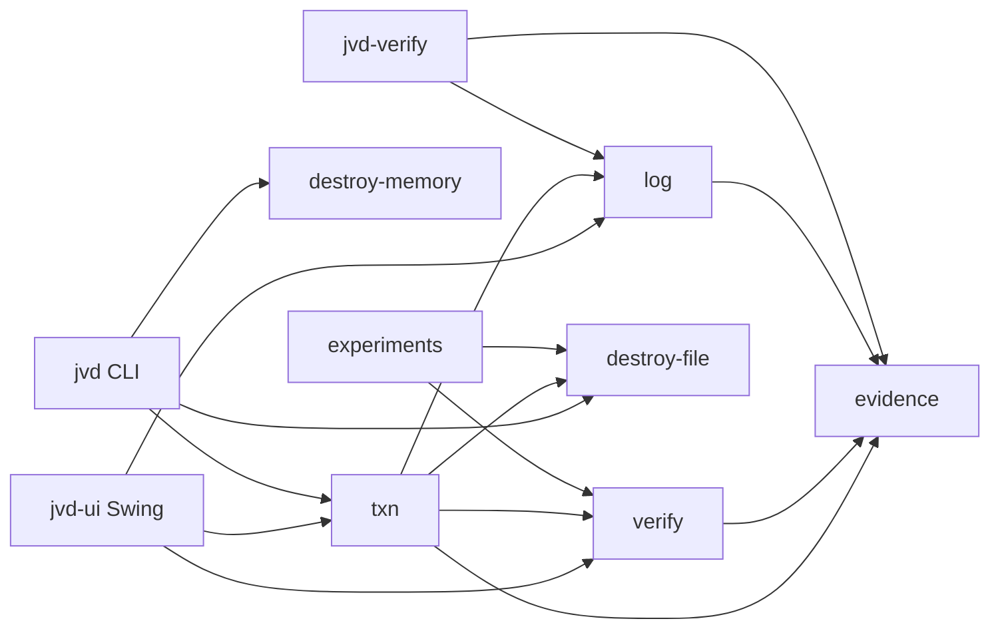
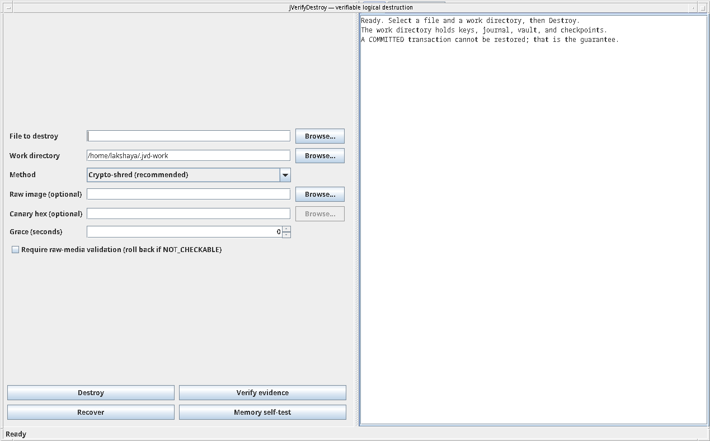

# jverifydestroy

Verifiable secure data destruction for Java, at the logical level.

`jverifydestroy` destroys a file or a memory secret, then **measures** what happened:
a child JVM is scanned for a canary, every run carries positive and negative controls,
and the result is written as Ed25519-signed evidence into an RFC 9162 Merkle log with a
witness cosignature. Destruction is a transaction: it can be rolled back before COMMIT,
and it is irreversible after COMMIT.

**It does not verify physical flash.** User-space Java cannot see the SSD flash translation
layer, bad-block pools, controller-held copies, journal copies, snapshots, or backups.
Every assurance level says so. See [docs/PLAN.md](docs/PLAN.md) and
[docs/RESEARCH_AUDIT.md](docs/RESEARCH_AUDIT.md).

## Quick start

The host default is JDK 21; this project targets **JDK 25** because the Foreign Function &
Memory API is final there. A Temurin 25 and Maven 3.9.16 are in `~/tools` on this machine.

```bash
export JAVA_HOME=$HOME/tools/jdk-25.0.5+8
export PATH=$JAVA_HOME/bin:$HOME/tools/apache-maven-3.9.16/bin:$PATH

mvn -q verify                 # unit + integration tests
scripts/jvd.sh selftest       # one control-validated memory run
scripts/jvd-ui.sh             # Swing desktop UI (JDK-only)
```

Destroy a file and commit a crypto-shred:

```bash
scripts/jvd.sh txn ./secret.txt --mode crypto --work .jvd-work
# state=COMMITTED ...
# validation=NOT_CHECKABLE dataAbsent=false
# assurance=A2 (crypto-shred committed; ... logical level only ...)

scripts/jvd.sh verify --work .jvd-work
# VALID size=1 root=...
```

Recover a transaction that crashed before COMMIT:

```bash
scripts/jvd.sh recover --work .jvd-work
```

Overwrite mode (NIST **Clear**, weak on flash):

```bash
scripts/jvd.sh txn ./secret.txt --mode overwrite --work .jvd-work
```

## Architecture



| Module | Responsibility |
|---|---|
| `evidence` | Canonical JSON, Ed25519, signed record with separate verification/validation, assurance levels |
| `log` | RFC 9162 Merkle tree, signed checkpoints, local witness cosignature, inclusion/consistency proofs, offline verifier |
| `destroy-memory` | `SecretBuffer` (FFM, wipe before close, mlock/MADV_DONTDUMP), best-effort heap wipe, String demo |
| `destroy-file` | Overwrite+fsync+delete (Clear), AES-256-GCM crypto-shred, 0600 key vault |
| `verify` | Canary derivation, child JVM victim, `/proc/<pid>/mem` scanner, mandatory controls, raw-image scanner |
| `txn` | Journaled state machine, vault, crash recovery, commit/rollback |
| `verifier-cli` | Offline `jvd-verify` |
| `cli` | `jvd` commands |
| `ui` | Swing desktop app: destroy, evidence JSON, verify, recover, memory self-test |
| `experiments` | N-trial matrices, CSV, generated `docs/RESULTS.md` |

## Desktop UI

`scripts/jvd-ui.sh` opens a Swing app — **completely Java, no external UI dependency**:

- file picker, work directory, crypto-shred vs overwrite
- optional raw image + canary hex, grace period, require-checkable
- Destroy, Verify evidence, Recover, Memory self-test
- live log tab and signed Evidence JSON tab



The UI is a thin shell over `AppService`, which calls the same txn/verify/log code as the
CLI. The backend tests (`AppServiceTest`) cover commit, verify, and rollback.

## Transaction semantics

```
STAGED -> VAULTED -> SCRUBBED -> VALIDATED -> [grace] -> COMMITTED
                                    \-> ABORTED (restore)
```

- **STAGED / VAULTED**: the original is untouched; a crash aborts and deletes the vault.
- **SCRUBBED / VALIDATED**: the original may be overwritten; a crash restores it from the vault.
- **COMMITTED**: the vault and key are destroyed. Recovery never restores.
  That irreversibility is the guarantee.
- A failed validation, or a `NOT_CHECKABLE` result under `--require-checkable`, rolls back.
- `--grace MS` delays COMMIT; rollback is still allowed during the wait.

The journal is JSONL, fsynced before each side effect. `kill -9` at every state is tested.

## Verification oracle

Every memory run starts a child JVM with three derived canaries:

1. **Target** — written into the object under test, then destroyed. Expected `NOT_FOUND`.
2. **Positive control** — never wiped, held in a static field. Expected `FOUND`.
   If it is not found, the scanner cannot see, and the run is `INVALID`.
3. **Negative control** — derived but never written. Expected `NOT_FOUND`.

The parent scans `/proc/<pid>/mem` for the masked canaries. It includes anonymous `rw`
regions, `[heap]`, and `/memfd:java_heap` (ZGC); it never scans itself and wipes its read
buffers. Results are `FOUND`, `NOT_FOUND`, or `NOT_CHECKABLE(reason)`. A run with a failed
control is `INVALID`, never a pass.

File validation is honest about its limits: path absence and vault/decrypt checks are
logical; a raw-image canary scan is `NOT_CHECKABLE` unless the caller supplies an image that
contained the canary **before** destruction. The pre-check is mandatory; an unrelated zero
image cannot produce a PASS.

## Evidence and log

The evidence record keeps NIST SP 800-88 Rev.2 §4.5.1 **verification** (the operation
completed) and §4.5.2 **validation** (the target data was effectively sanitized) as separate
fields. The record is canonicalised and Ed25519-signed. The log uses RFC 9162 leaf/node
hashing; a checkpoint signs `(origin, size, root)`, and a local witness cosigns it.
`jvd-verify` checks the record signature, leaf hashes, checkpoint signature, witness
signature, size, root, inclusion, and consistency. It detects edited, deleted, backdated,
truncated, and forked logs — provided the verifier has a checkpoint it already trusts.

The witness is a second key on the same machine, not an independent party. A dishonest
operator who controls both keys and withholds every old checkpoint can rewrite history.
A3 narrows that window; it does not eliminate it.

## Assurance levels

| Level | Meaning |
|---|---|
| A0 | deletion only |
| A1 | best-effort overwrite + logical checks; physical media NOT verified |
| A2 | crypto-shred committed, key destroyed, decrypt fails, required checks pass; canary controls apply only to memory subjects; logical level only |
| A3 | A2 + witness-cosigned checkpoint + independent process re-validation; logical level only |

## Claims and where they are tested

| Claim | Test / evidence |
|---|---|
| `SecretBuffer` wipes before close and rejects use after close | `SecretBufferTest` |
| Heap wipe is best effort, not a guarantee | `HeapWipeTest`; `docs/SPIKES.md` H1 |
| Crypto-shred key destruction makes decryption fail | `CryptoShredderTest`; `DestructionTransactionTest` |
| Rollback restores a file before COMMIT | `DestructionTransactionTest`; `Kill9RecoveryTest` |
| No restore after COMMIT | `DestructionTransactionTest`; `Kill9RecoveryTest` |
| Edited/deleted/backdated/forked log is detected | `LogTest` |
| Inclusion/consistency proofs verify for all tested sizes | `MerkleTest` |
| A known-present control canary is found | `MemoryScannerTest`; `CanaryVerifierTest` |
| A failed control makes the run INVALID | `CanaryVerifierTest` |
| Serial/Parallel/Shenandoah can leave a stale copy after a move; ZGC is rare, G1 was 0/200 | `docs/SPIKES.md` H2; `docs/RESULTS.md` |
| Default heap dump omits unreachable objects; `-all` includes them | `docs/SPIKES.md` H3 |
| mlock/MADV_DONTDUMP work through FFM | `NativeLockTest`; `docs/SPIKES.md` H5 |
| Physical flash is not verified | not a claim; `docs/PLAN.md` threat model |

## Limits (read this before quoting a number)

- Logical-level only. No raw device, no `ioctl`, no NVMe sanitize, no TPM.
- GC and JIT behaviour is JDK- and flag-specific. Results record the JDK, GC, and flags;
  they do not generalise to every JVM.
- The scanner can only see mappings it is allowed to read. If `/proc/<pid>/mem` is blocked,
  the result is `NOT_CHECKABLE`, not a pass.
- `mlock` is limited by `RLIMIT_MEMLOCK` (8 MiB on this host); large secrets are not fully
  locked.
- The witness is local; fork detection needs an old checkpoint the verifier trusts.
- The file overwrite path is NIST Clear. It does not sanitize an SSD.
- The ext4 image overwrite experiment was not completed; the delete-only branch ran. See
  `docs/SPIKES.md` H6. No overwrite-on-ext4 claim is made.
- A crash in the narrow window between destroying the key/vault and journaling COMMITTED
  cannot be restored. Recovery reports the failure; it never claims a restore it did not make.

## Research

- [docs/RESEARCH_AUDIT.md](docs/RESEARCH_AUDIT.md) — claim-by-claim audit; corrections to the
  inherited report; prior art (merklon, `gdpr-shredding`, `cryptoshred`, Microsoft patents).
- [docs/SPIKES.md](docs/SPIKES.md) — H1–H6 raw results.
- [docs/PLAN.md](docs/PLAN.md) — scope, state machine, threat model, evaluation, deviations.
- [docs/ASSUMPTIONS.md](docs/ASSUMPTIONS.md) — every resolved ambiguity.
- [docs/RELATED_WORK.md](docs/RELATED_WORK.md) — honest novelty statement.
- [docs/RESULTS.md](docs/RESULTS.md) — generated from `experiments/out/results.csv`.

## Licence

No licence file yet; add one before publishing. The code is original except where
`docs/RELATED_WORK.md` credits prior art.
