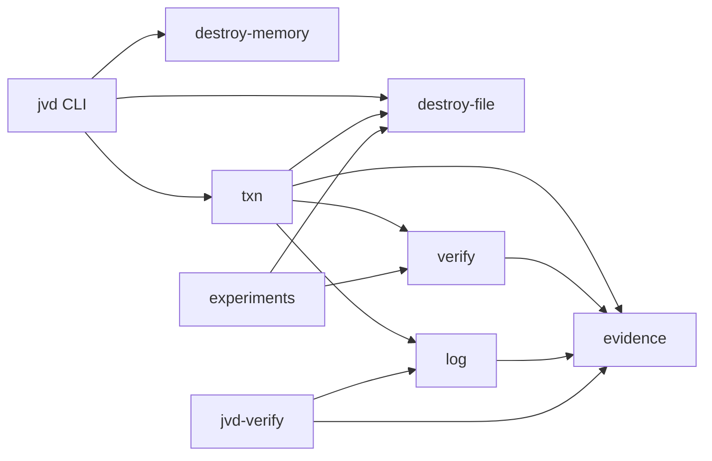

# PLAN — jverifydestroy

Status: planning complete; build follows this document.
Scope owner: student team, Linux-first, user-space only.
Core spec: report v1 §6, with the deviations listed in §12.

## 1. Final scope

Build a Java library + CLI that destroys data at the logical level and then *measures* what
happened, with tamper-evident evidence and a rollback window that ends at COMMIT.

In scope:

- MEMORY: off-heap `SecretBuffer` with explicit wipe before close; best-effort heap wipe
  utilities; a String-misuse demonstration.
- FILE_OVERWRITE: overwrite + fsync + delete, labelled NIST **Clear** and weak on flash.
- CRYPTO_SHRED: per-file AES-256-GCM key, encrypt-then-delete, commit by destroying the key.
- A journaled destruction transaction with crash recovery and rollback before COMMIT.
- Canary validation in a child JVM, with positive and negative controls on every run.
- Ed25519-signed evidence that keeps NIST verification and validation as separate fields.
- An RFC 9162 Merkle log with signed checkpoints, a local witness co-signature, inclusion
  and consistency proofs, and an offline verifier.
- Experiments that measure false-assurance rates, control sensitivity, tamper detection,
  rollback correctness, and overhead.

Out of scope, explicitly:

- Physical flash sanitization, FTL remapping, bad-block pools, controller-held copies.
- Raw device access, `ioctl`, NVMe sanitize, TPM/TPM2, SGX, Caliptra/OCP LOCK.
- Blockchain, network calls, cloud KMS, hardware attestation.
- A claim that overwrite is NIST Purge or that it sanitizes an SSD.
- Restoring data after COMMIT. That is impossible by design and the tool must never offer it.

## 2. Architecture



Dependency direction is acyclic:

```
evidence <- log <- txn
evidence <- verify <- txn
destroy-file <- txn
destroy-memory (independent)
cli -> all
verifier-cli -> evidence, log
experiments -> verify, evidence, log
```

## 3. Modules

| Module | Responsibility | Key classes |
|---|---|---|
| `evidence` | Canonical JSON, Ed25519, signed evidence record, assurance levels, NIST mapping | `Json`, `Ed25519`, `EvidenceRecord`, `AssuranceLevel` |
| `log` | RFC 9162 Merkle tree, JSONL store, signed checkpoints, witness cosignature, inclusion/consistency proofs, verifier | `Merkle`, `LogStore`, `Checkpoint`, `Witness`, `LogVerifier` |
| `destroy-memory` | Off-heap secret storage, explicit wipe, mlock/MADV_DONTDUMP, heap wipe, String demo | `SecretBuffer`, `NativeLock`, `HeapWipe`, `StringMisuseDemo` |
| `destroy-file` | Overwrite+fsync+delete; AES-256-GCM crypto-shred; key vault | `FileDestroyer`, `CryptoShredder`, `FileKeyVault` |
| `verify` | Canary derivation, child JVM victim, `/proc/<pid>/mem` scanner, controls, raw-image scanner | `Canary`, `MemoryScanner`, `VictimProcess`, `CanaryVerifier`, `CanaryVictim`, `FileScanner` |
| `txn` | State machine, write-ahead journal, vault, crash recovery, commit/rollback | `DestructionTransaction`, `Journal`, `State`, `Recovery`, `Vault` |
| `verifier-cli` | Offline verification of evidence + log + checkpoints + witness | `Main` |
| `cli` | `jvd` user commands | `Main` |
| `experiments` | N>=200 trial matrices, CSV/Markdown generation | `Main`, `MemoryMatrix`, `TamperMatrix`, `Overhead` |

## 4. Transaction state machine

```
STAGED
  |  journal fsync
  v
VAULTED          (encrypted rollback copy + wrapped key on disk)
  |
  v
SCRUBBED         (original overwritten or ciphertext-only; fsync; unlink)
  |
  v
VALIDATED        (control-validated canary result; required checks pass)
  |
  v  optional grace window (still rollback-able)
COMMITTED        (vault + key destroyed; evidence appended; checkpoint witnessed)
  |
  v
POST_COMMIT_VALIDATION (crypto: decrypt must fail; file: path absent; memory: rescan)
```

Rules:

- A crash at STAGED or VAULTED restores nothing because the original is untouched; recovery
  marks the transaction ABORTED and deletes the vault.
- A crash at SCRUBBED or VALIDATED restores from the vault on recovery, because COMMIT was
  never reached. The restored file is the original plaintext.
- A crash at COMMITTED never restores. Recovery marks it COMMITTED and verifies the key is
  gone.
- Rollback is allowed only before COMMIT. The CLI must print that boundary.
- A failed required validation → ABORTED + rollback. A `NOT_CHECKABLE` raw-media scan is
  recorded but is not a required check for FILE_OVERWRITE under the default policy; see §12.

## 5. Assurance levels

| Level | Meaning |
|---|---|
| A0 | Deletion only. No overwrite, no validation. |
| A1 | Best-effort overwrite + logical checks (path absent, file readable as zeros). No raw-media validation. “Physical media NOT verified.” |
| A2 | Crypto-shred committed, key destroyed, decrypt fails, required checks pass. Canary controls are required for memory subjects and marked N/A for file-level transactions. Logical level only. |
| A3 | A2 + witness-cosigned checkpoint + parent-process re-validation of a separate victim JVM + offline verifier passes. |

Every level carries the same residual-risk line: user-space Java cannot verify the SSD flash
translation layer, bad-block pools, controller-held copies, backups, snapshots, or copies made
before the tool ran. A3 is not “physically erased”.

## 6. Verification oracle

`CanaryVerifier` runs three checks in one child JVM:

1. **Target**: a canary written into the object under test, then destroyed by the method
   under test. Expected NOT_FOUND if destruction worked; FOUND is a failure.
2. **Positive control**: a second canary, never wiped, held in a static field. Expected FOUND.
   If it is NOT_FOUND, the scanner cannot see, so the whole run is INVALID.
3. **Negative control**: a third canary, derived but never written. Expected NOT_FOUND.

The parent scans `/proc/<pid>/mem` for the masked target and control patterns. It reads
readable `rw` regions, including anonymous regions and `/memfd:java_heap` (ZGC). It skips
file-backed mappings except `[heap]` and `/memfd:`. It wipes its read buffer after each
chunk. It never scans its own process. Results:

- `FOUND` — at least one match.
- `NOT_FOUND` — no match in the scanned regions, with the region count and byte count recorded.
- `NOT_CHECKABLE(reason)` — permission denied, no readable regions, or the process exited.

A run with a failed positive or negative control is `INVALID`, not `PASS`.

File validation uses `FileScanner` on a caller-supplied raw image (for example an ext4 image
or a loop device file). The image is pre-scanned before destruction; if the canary is not
found there, the image is not a witness for this file and the result is `NOT_CHECKABLE`.
Without an image, the result is `NOT_CHECKABLE("no raw image supplied")`.
The tool never pretends that reading a path back is a raw-media check.

## 7. Evidence and log

`EvidenceRecord` fields:

- `schemaVersion`, `eventId`, `timestamp`, `subjectHash` (salted SHA-256 of the path/name),
  `method` (`CLEAR`/`PURGE`/`DESTROY` as mapped), `technique`, `tool`, `toolVersion`,
  `jvm`, `os`, `gc`, `jvmFlags`.
- `verification`: operation completed, tool exit status, anomalies. NIST §4.5.1 sense.
- `validation`: data absent, checks[], controls{positive, negative}, result
  (`PASS`/`FAIL`/`NOT_CHECKABLE`/`INVALID`). NIST §4.5.2 sense.
- `residualRisk`, `assuranceLevel`.

The record is canonicalised (sorted keys, UTF-8, no insignificant whitespace) and signed with
Ed25519. The log leaf is `SHA-256(0x00 || recordBytes)`; internal nodes are
`SHA-256(0x01 || left || right)`, per RFC 9162. A checkpoint is the C2SP-style note text
(origin, size, base64 root) signed by the log key. A witness signs the checkpoint with its own
key and a timestamp. The verifier checks the record signature, the leaf hash, the inclusion
proof, the checkpoint signature, the witness signature, the size, and consistency against a
previous checkpoint.

What the log detects: edited record (signature/root mismatch), deleted record (size/leaf
count mismatch), a truncated log (consistency proof failure), a fork (two checkpoints at the
same size with different roots, or a witness signature over a different root). What it does
not detect without an external witness or trusted time: a log operator who controls all keys
and never published a checkpoint can rewrite history. The local witness is a separate key
file, not an independent party; the README says so.

## 8. Threat model

Defends against:

- A secret left in JVM heap/native memory after a claimed wipe, in the locations the scanner
  can read (heap, anonymous mappings, ZGC memfd).
- A tool that reports “destroyed” when the file still exists, the path is still readable, or
  the crypto-shredded ciphertext still decrypts.
- A crash during destruction leaving a half-destroyed file or a false COMMITTED status.
- A failed validation before COMMIT; the transaction rolls back and records ABORTED.
- Editing, deleting, backdating, or forking the evidence log, provided the verifier has the
  original checkpoint/witness signature.
- A dishonest operator who edits the JSON after the fact: the Ed25519 signature and the
  Merkle root fail.

Does not defend against:

- Physical SSD/flash remapping, wear leveling, bad-block pools, controller-held copies.
- Copies made before the tool ran: backups, snapshots, replicas, page cache, swap, core dumps,
  another process that read the file.
- A compromised JVM, OS, kernel, or scanner process; a debugger attached to the victim.
- A malicious operator who controls the log key and the witness key and withholds all old
  checkpoints. The evidence is tamper-evident only relative to a checkpoint the verifier
  already trusts.
- Cold-boot, DMA, or hardware attacks; TPM/secure enclave attestation.
- `SecretBuffer` pages that the OS swapped before mlock, or memory the JVM copied into
  registers/JIT structures before the wipe.
- Deletion from storage the tool cannot see (remote object stores, SaaS, replicas).

Trust boundaries: the parent verifier process is trusted; the victim JVM is untrusted and may
lie; the witness key is separate from the log key; the offline verifier trusts only the
public keys it is given.

## 9. Test plan

Unit:

- `evidence`: JSON round trip, canonical form, Ed25519 sign/verify, one-byte tamper fails.
- `log`: RFC 9162 leaf/node hashes; inclusion proof for every index at sizes 1..64; consistency
  proof for all size pairs 1..64; checkpoint signature; witness signature; edited/deleted/
  backdated/forked log detection.
- `destroy-memory`: `SecretBuffer` reads back, wipe yields zeros, close wipes, double close is
  safe; `HeapWipe` zeros byte[]/char[]; `NativeLock` reports success or a reason.
- `destroy-file`: overwrite changes bytes and deletes; crypto-shred decrypts before commit and
  fails after key destruction; wrong key fails; tampered ciphertext fails (GCM tag).
- `verify`: positive control found, negative control not found, target not found after wipe,
  a deliberately un-wiped target yields FOUND, a failed control yields INVALID, a bad pid
  yields NOT_CHECKABLE.
- `txn`: state transitions, journal fsync, rollback restores, commit destroys the vault,
  recover at every state, kill -9 at every state, no restore after COMMIT.

Integration:

- End-to-end `jvd txn --mode crypto` produces an evidence record, appends it to the log,
  writes a checkpoint, and `jvd-verify` accepts it.
- Tamper the evidence JSON / delete a log line / backdate a record / fork the checkpoint and
  confirm `jvd-verify` rejects each.
- Run a memory transaction, then independently scan the victim process.

## 10. Evaluation plan

- **Memory matrix**: 5 collectors (Serial, Parallel, G1, ZGC, Shenandoah) × modes
  (`wipe`, `move`, `hot`) × 200 trials. Every trial has a positive and negative control.
  Report false-assurance rate (tool says wiped, target canary found) with Wilson 95% CI.
- **Control sensitivity**: the positive-control FOUND rate per collector; a rate below 100%
  means the scanner is not reliable on that collector and the cell is NOT_CHECKABLE.
- **File matrix**: plain-file overwrite/delete, crypto-shred, delete-only baseline, 200 trials
  each. Raw-image residue measured only when an image is supplied; otherwise report
  NOT_CHECKABLE, not zero.
- **Tamper matrix**: 200 edited records, 200 deleted records, 200 backdated records, 200
  forked checkpoints; detection rate with CI.
- **Rollback**: 20 kill -9 trials at each state; count restores and false COMMITTED.
- **Overhead**: ms and MiB/s for 1 MiB, 16 MiB, 64 MiB files; median and p95.
- **Statistics**: Wilson 95% CI; rule of three for zero-event cells (0/n bounds the rate below
  about 3/n at 95%, not zero).

## 11. Risk list

| Risk | Impact | Mitigation |
|---|---|---|
| JVM/GC version changes the leak behaviour | Results do not generalise | Record JDK, GC, flags for every row; re-run on the team’s JDK; never claim a JDK-independent guarantee |
| `/proc/<pid>/mem` blocked by Yama/ptrace permissions | Scanner cannot run | Detect and return NOT_CHECKABLE, not NOT_FOUND; document `ptrace_scope`; fallback is a self-dump, which is weaker and marked as such |
| `mlock` limit (8 MiB here) | Cannot lock large secrets | Report the limit; lock small key material only; fall back with a reason |
| No root / no raw device | H6 and physical claims impossible | Logical-level only; file validation NOT_CHECKABLE without a raw image |
| `mkfs` blocked by the agent guard | H6 ext4 overwrite branch not run | Keep the script; do not cite an unrun result; file claims stay Clear/logical |
| Local witness is not independent | Fork detection is weaker than a real witness | Separate key file, explicit README limitation; an external witness is future work |
| Log key and witness key on the same disk | Operator can rewrite both | Document; A3 requires the verifier to hold an old checkpoint; future: remote witness |
| Vault plaintext copy during rollback | Confidentiality exposure if the vault key leaks | Vault is AES-GCM under a 0600 key file; delete both at COMMIT; threat model says so |
| Crypto-shred key file copied before commit | Key can decrypt the ciphertext later | Key file is 0600; commit overwrites then deletes; backups are out of scope |
| Crash between destroying the key/vault and journaling COMMITTED | Recovery cannot restore, and it must not claim it did | Recovery reports restore failure and ABORTED; the narrow window is documented as a residual risk, not hidden |
| Patent prior art (Microsoft US20260030390A1, US20260228352A1) | Novelty/claims risk | Do not claim “attestable secure erase” or “immutable proof-of-erasure”; cite prior art; focus on measurement |
| Scope creep | Student team cannot finish | Cut features, not verification quality; no GUI, no network, no blockchain |

## 12. Deviations from report v1 (and why)

1. **JDK 25, not “22+”.** 25 is the newest LTS on the host and FFM is final. The build targets
   `--release 25`. The report said “use 22+; check java -version”; this is the check.
2. **N-4 novelty is dropped.** merklon already implements an RFC 9162 log with witness
   cosigning and an offline verifier on the JVM. The project still builds its own log because
   the brief requires it, but RELATED_WORK credits merklon and the novelty claim is limited to
   the destruction-evidence integration.
3. **`/proc/<pid>/mem` is the primary verifier, not a heap dump.** H3 showed that the default
   heap dump performs a full GC and can destroy the evidence, and that `-all` must run on a
   fresh process. The heap dump is a secondary artifact; the parent scanner is primary.
4. **The scanner never scans itself, and it wipes its read buffer.** H4 showed that a self-scan
   finds the scanner’s own 1 MiB buffer even after the target array is wiped. Masking the
   needle alone is insufficient.
5. **Positive and negative controls are mandatory on every run.** A control failure makes the
   run INVALID; this is enforced in `CanaryVerifier`, not left to the caller.
6. **Collector-specific results are reported, not averaged.** H2 found stale copies on Serial,
   Parallel, and Shenandoah, but not on G1 or ZGC. The experiments report per collector and
   never claim “Java GCs leak” in general.
7. **FILE_OVERWRITE validation is NOT_CHECKABLE without a raw image.** The tool does not treat
   “path absent” as proof of raw-media erasure. The report’s “failed verification → rollback”
   is applied to required checks; the raw-image check is optional and its absence is recorded,
   not silently passed. The default policy is `ALLOW_LOGICAL` for FILE_OVERWRITE and
   `REQUIRE_CHECKABLE` for CRYPTO_SHRED.
8. **Crypto-shred keys are byte[]/off-heap, not `SecretKeySpec`.** C-9’s probe showed
   `SecretKeySpec.destroy()` always throws. The key vault owns the bytes and wipes them.
9. **The witness is a local key file, not an independent service.** No network calls are
   allowed by the brief. This detects forks only if the verifier retains an old checkpoint;
   the README says so.
10. **H6 is partial.** The ext4 image probe’s delete-only branch ran; the overwrite branch did
    not, because the agent’s hardline guard blocks `mkfs.ext4` and the script’s block parser
    failed. The script is kept for a human to run; no overwrite-on-ext4 claim is made.
11. **An `experiments` module is added.** It is not in the report’s module list, but the
    evaluation plan needs runnable code. It depends on `verify` and `evidence`; it is not part
    of the library’s runtime path.
12. **Grace window is a delay before COMMIT, not a soft-delete feature.** During grace the
    transaction is VALIDATED and rollback is allowed. At COMMIT the vault and key are
    destroyed; there is no post-COMMIT restore.
